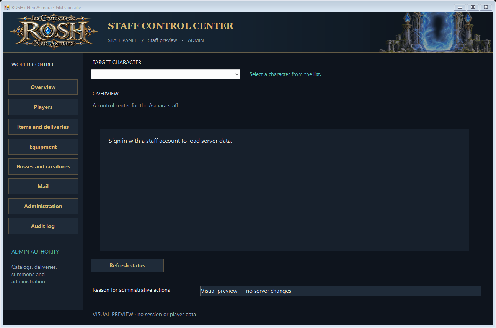
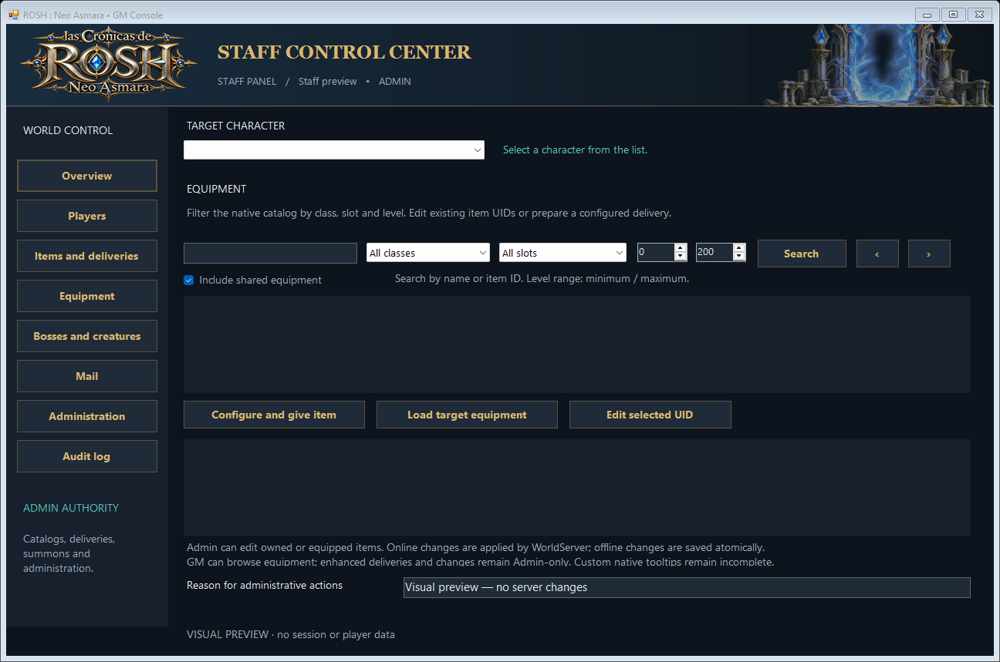

# GM Tool

The Neo Asmara staff console, distributed as compiled applications. The folder keeps its existing name; Core and tool source code are not included.

## Preview

<table><tr><td width="50%"></td><td width="50%"></td></tr></table>

These are application-rendered previews with demonstration data, not a live staff session.

## Requirements

| Component | Requirement |
|---|---|
| Staff console | .NET Framework 4.8 / Windows Forms |
| GM backend | Windows x64 and the included native DLLs |
| Server | An initialized Neo Asmara Core installation |
| Login | A normal game account with a GM or Admin character |

## Connect

Configure the intended Core folder and GM service port before signing in. Keep the console executable, native service, assets and DLLs together when moving this tool.

Accounts are empty in the public package. Create a normal account and character first, then use the Core operator console to assign the appropriate staff role. There is no bundled administrator password.

The local test configuration can omit the separate staff password. It still checks the account password and staff role. Removing a role must revoke access to privileged actions.

## Operations

The console exposes player lookup, item delivery, equipment filtering/configuration, mail, creature lookup and administrative operations supported by the selected Core build. Item actions and provenance are stored by the server; a GUI confirmation alone is not proof that an item reached a player.

GM and Admin permissions differ. Do not use a player account as a shared staff account.

## Moving the tool

The server location is configuration, not a development checkout path. Update that configuration when moving the server to a different directory or computer. A tool connected to another installation must not silently fall back to the developer's original server.

---

Donations are optional. Thank you for supporting the project.
