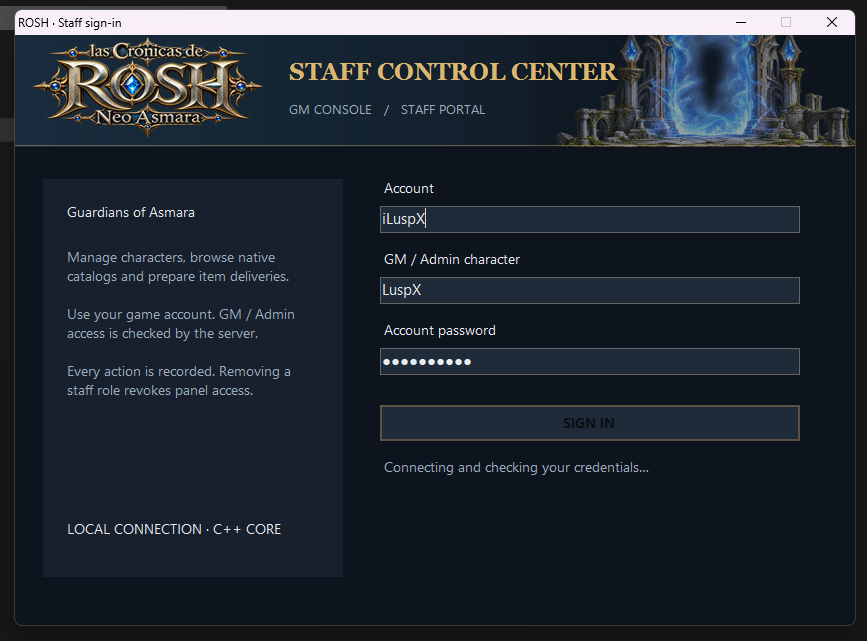
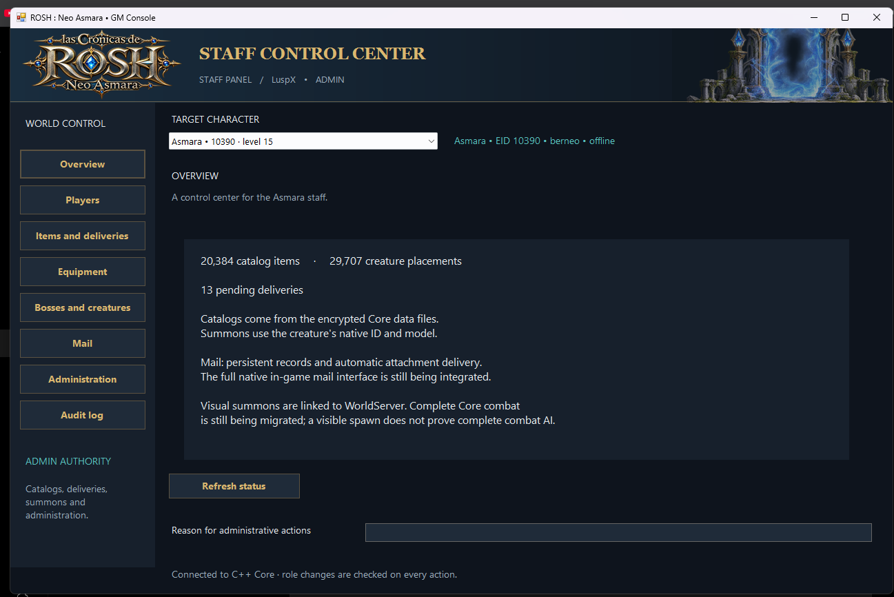
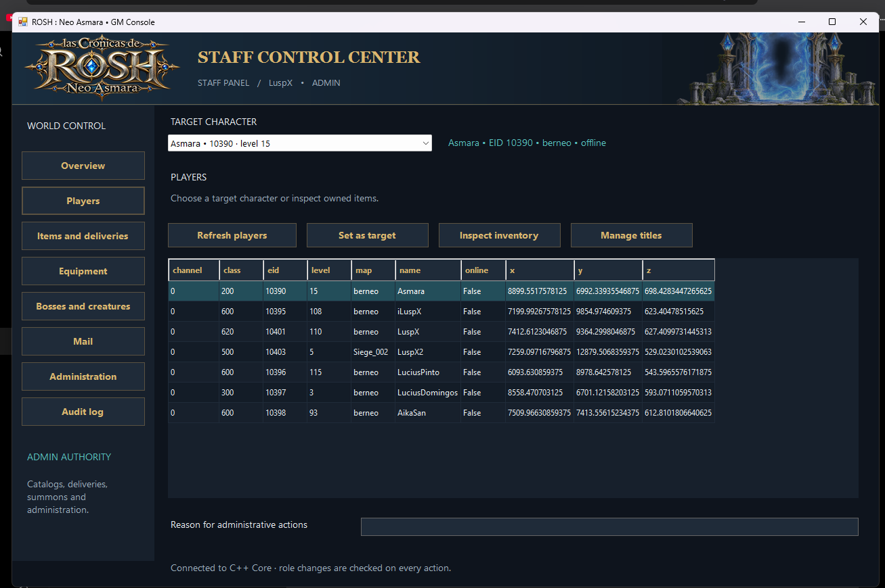
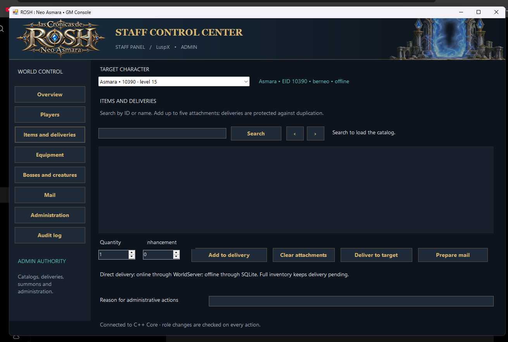
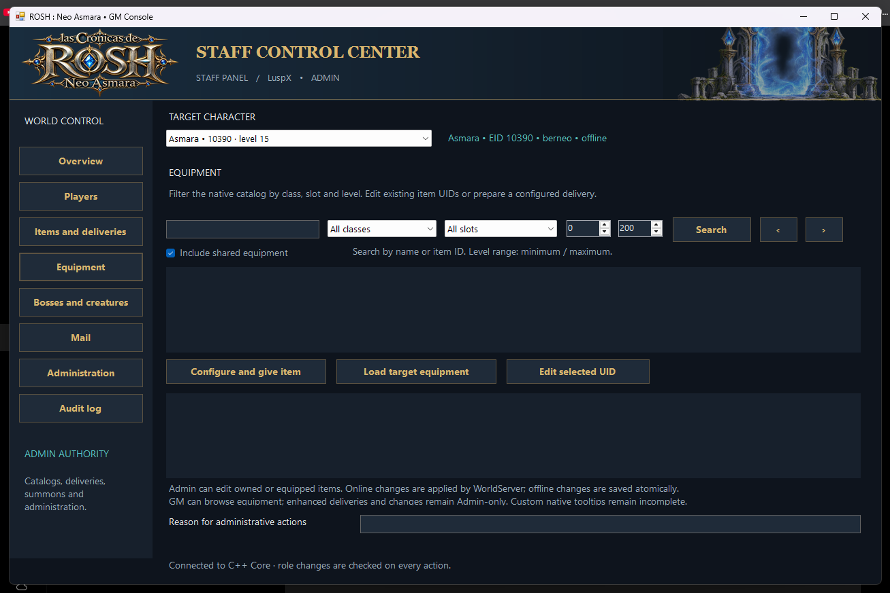
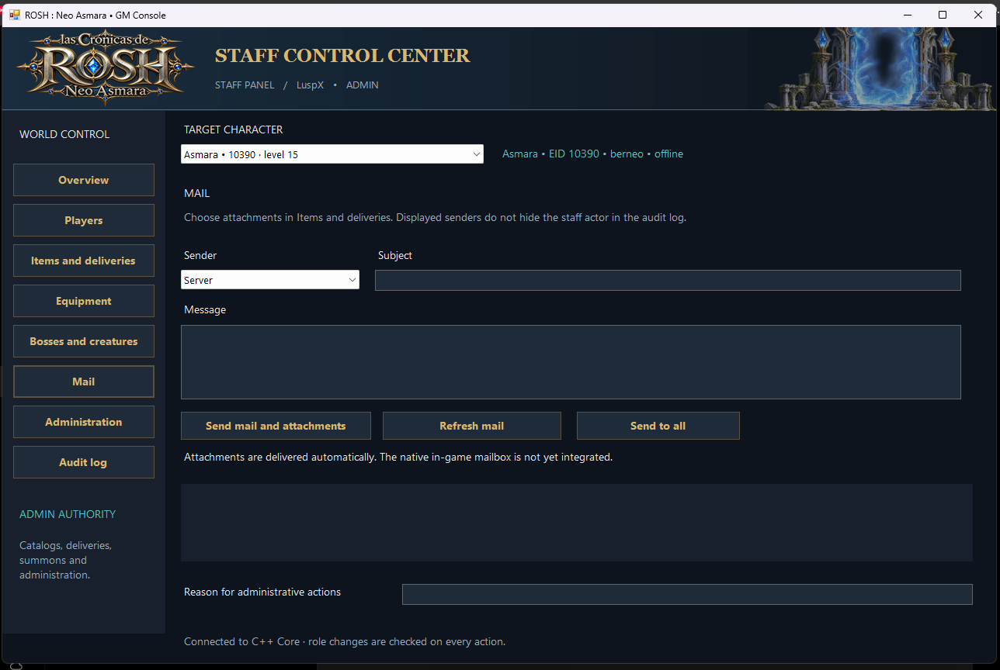
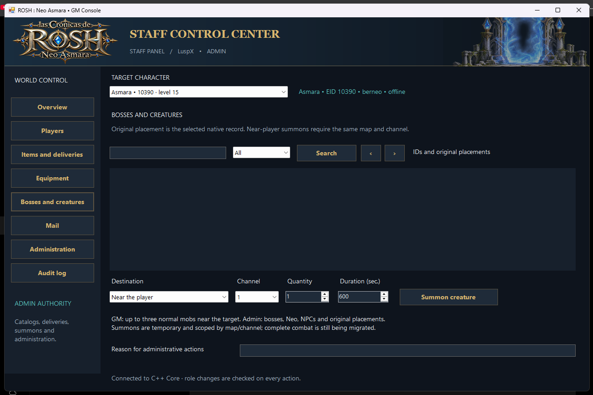
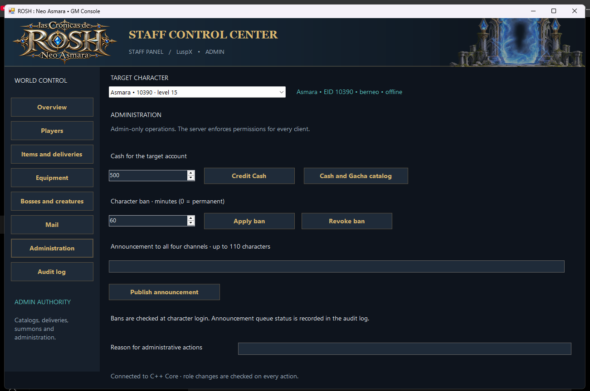
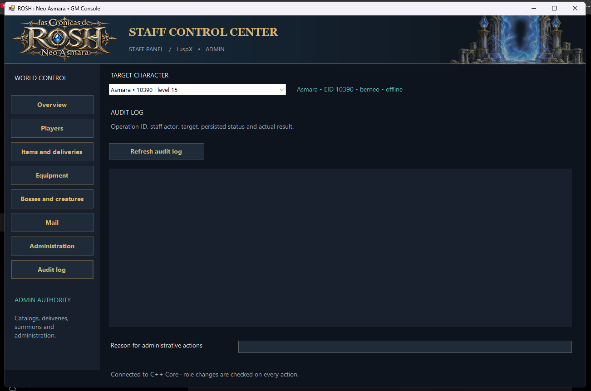

<div align="center">

# NeoAsmara GM Tool
### Staff Control Center · Game Master & Administrator Console

**Native desktop administration interface for the NeoAsmara C++ Core**

*Player management · Item delivery · Equipment · Creature summons · Mail · Administration · Audit trails*

[**View the full visual showcase**](./index.html) · [**Screenshots**](#interface-gallery) · [**Current limitations**](#current-development-status)

</div>

---

## Overview

**NeoAsmara GM Tool** is a dedicated staff administration console designed for the NeoAsmara emulator environment. The interface shown here connects to the C++ Core and provides separate workflows for Game Masters and Administrators, with server-side permission checks described in the application.

This repository presentation documents the **interface demonstrated in the screenshots**. Some backend operations and end-to-end game-client behavior are still under development or have not been independently verified.

## Interface gallery

### 01 — Staff authentication
Account, staff-character and password fields, with server-side role validation indicated in the interface.



### 02 — Operations overview
Displays catalog and delivery indicators and summarizes current integration status. The screenshot shows **20,384 catalog items**, **29,707 creature placements**, and **13 pending deliveries** in that environment; these are snapshot values, not universal guarantees.



### 03 — Player management
Character selection with class, level, map, online status and world coordinates; player refresh and inventory inspection actions.



### 04 — Items and deliveries
Item searches by name/ID, attachment preparation (up to five attachments in the shown interface), quantities, enhancement controls, delivery and mail preparation.



### 05 — Equipment management
Catalog filters by class, equipment slot and level, with controls for configured deliveries and editing item UIDs.



### 06 — Bosses and creatures
Creature lookup and temporary summon controls, including destination, channel, quantity and duration. The interface distinguishes GM and Admin permissions.



### 07 — Mail
Mail composer with sender selection, subject, message, and attachment-related actions.



### 08 — Administration
Admin-only controls shown for cash credit, character bans, ban revocation and announcements across channels.



### 09 — Audit log
Dedicated interface for reviewing staff activity, operation IDs, targets and recorded results.



## Key capabilities

| Area | Interface features shown |
| --- | --- |
| Authentication | Game account + GM/Admin character sign-in; role validation indicated |
| Players | Search/list targets, inspect inventory, manage titles |
| Deliveries | Item catalog search, attachment preparation, online/offline delivery workflow |
| Equipment | Filters for class/slot/level; item configuration and UID editing controls |
| World control | Temporary creature summons, destination and channel selection |
| Mail | Message preparation, attachments and send-to-all control |
| Administration | Cash, bans, channel announcements |
| Audit | Staff activity review and operation result tracking |

## Current development status

This tool accompanies an **experimental Core under active development**. Its interfaces may be ahead of some server- or client-side features. The screenshots explicitly note that:

- The **native in-game mailbox** integration is not yet complete.
- Some **creature combat behavior** is still being migrated even when visual summons work.
- **Custom native equipment tooltips** are incomplete.
- Live behavior depends on the running NeoAsmara C++ Core and its implemented endpoints.

The gallery shows the features exposed by the application; it does **not** certify every workflow as fully tested.

## Showcase page

The included [`index.html`](./index.html) provides a standalone, visual HTML presentation using all nine screenshots embedded into the page. For a full interactive presentation online, publish `index.html` through **GitHub Pages**. GitHub READMEs render images and Markdown but do not run arbitrary page scripts or styles.

## Repository contents

```text
NeoAsmara-GMTool/
├── README.md
├── index.html                 # Standalone showcase with embedded screenshots
└── screenshots/
    ├── 01-sign-in.png
    ├── 02-overview.png
    ├── 03-players.png
    ├── 04-items-deliveries.png
    ├── 05-equipment.png
    ├── 06-bosses-creatures.png
    ├── 07-mail.png
    ├── 08-administration.png
    └── 09-audit-log.png
```

> **Note:** This package is a **GitHub presentation kit**, not the GM Tool executable or its source code. Add technical build/install instructions only after verifying the actual application dependencies and distribution conditions.

## Project notice

NeoAsmara is an independent emulator-development project. Third-party game names, logos, artwork and assets remain the property of their respective owners. This presentation is not an official game publisher product.

**Project attribution:** LuspX_ / NeoAsmara (as provided by the project author).  
**License:** No license text is included in this presentation pack; apply the actual distribution terms separately before publishing software or source files.
